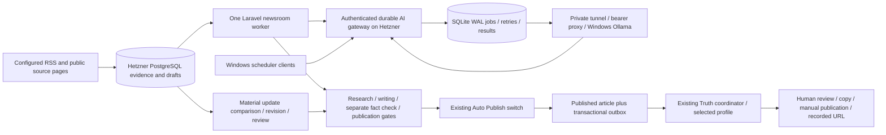

# Local newsroom integration: architecture and review

Status: implementation prepared for review, not a production certification. No production deployment, DNS change, live Truth Social posting, or real-model quality/performance claim is included. Read DEPLOYMENT.md before enabling the workers.

## Repository audit

The website is the existing Laravel/Filament application in `pulse`, with PostgreSQL 16, Redis 7, Caddy 2 and PHP 8.3 containers. Existing research packets, source relationships, exact-quote checks, event lifecycle checks, revisions, SEO, image variants and admin pages were reused. The scheduler is the existing Python/Tk client and stdlib HTTP/SQLite central coordinator. Existing configuration and history paths remain compatible; a separate SQLite database handles gateway jobs.

Draft website PR #2 was reviewed against main. Its feed discovery helper and headline-match tests were useful and reused. The PR was incomplete because only AiClient had been routed locally: utility writers, SEO, captions, moderation, commands, images and embeddings could still use paid APIs. It did not provide the scheduler/coordinator bridge, durable shared capacity management or secure GPU connectivity. Its CPU Ollama overlay did not match the user's Windows GPU architecture. A host count alone did not prove independent reporting; generated draft text was unsafe as source fallback; freshness timestamps alone did not justify updates. This implementation replaces those assumptions with existing source-relationship analysis, stored source evidence, material-change comparison and reviewable revisions. PR #2 was not merged or modified.

## Paid dependency inventory

| Area | Existing call sites | Local behavior |
|---|---|---|
| Editorial pipeline | AiClient, ResearchAnalyst, FactChecker, Rewriter | AiTransport submits durable gateway jobs; same configured local model, separate prompts |
| Utility text | SeoAnalyzer, SeoBooster, LinkEnricher, TagGenerator, SocialCaptionService, CommentModerator | Shared AiTransport adapter; local cost recorded as zero API spend |
| Scheduled content | OpinionsGenerate, PollsDaily, QuizDaily, StyleLearn | Same transport, no implicit provider switch |
| Model discovery | AiModels | Local model config; no paid model-list request |
| Images | ImageService, ImageAuditor | No paid generation/vision in local mode; review/owned assets/category fallback |
| Embeddings | Deduplicator | Paid embedding disabled locally; existing deterministic checks and event identity remain |
| Python text | ai_commenter, ai_daily_posts, ai_priority, engager_followup | Shared ai_provider; priority is deterministic locally |
| Optional search | WebResearcher | Separate explicitly configured Brave/Google subscription; not claimed free |

Existing OpenAI URLs remain as compatibility operation selectors in PHP; local AiRequest never sends requests to those URLs. A global HTTP middleware additionally blocks OpenAI destinations in local mode. OpenAI requires explicit `AI_PROVIDER=openai` / Python `ai.provider=openai`. A saved paid key does not activate it. Images also require their separate explicit paid-image switch, and remain disabled in local mode.

## Processing and recovery

Discovery no longer requires the GPU. It saves source publication/retrieval times and source text, then queues an unwritten draft. RSS `updated` never substitutes for original publication. Unknown/future/stale sources are logged for review. RSS candidates plus optional search supply evidence; duplicate wire text and related reporting groups are assessed before writing. Headline matching is discovery only, and can miss stories with very different titles; editors can add sources and optional search can improve recall.

The queued workflow requires three source records and existing independent-source/event assessment, then writing, a separate verification call, deterministic chronology/quote/originality checks, SEO and FinalCheck. All calls use one persistent evidence snapshot during retries. Successful drafts remain drafts if their feed's Auto Publish is off. There are no daily news caps, score thresholds, category quotas or scheduled publication slots. Capacity is bounded at 100 outstanding Laravel article jobs and 200 AI jobs, with one GPU call at a time. These are operational queue bounds, not publication quotas. Over-capacity candidates remain in PostgreSQL.

The local model is not an independent human fact checker. It can make correlated mistakes across research and review. Real-model evaluation and editorial sampling are mandatory acceptance steps, particularly for sensitive claims and quotations.

Gateway jobs use idempotency keys and payload fingerprints. A disconnected client can resubmit identical input; a completed result is reused. Network/429/5xx errors back off with jitter without dropping jobs. Invalid JSON/schema, output truncation, leaked thinking or model/configuration errors enter a failed state for operator review. A process lock enforces one gateway instance; restart recovers running work. Changing a request changes its key. New evidence, changed prompts or a new model appropriately produce new jobs.

Local source excerpts are bounded to complete sentences and reused across stages. Compact local prompts preserve factual rules; the full human editorial policy remains in the repository. The gateway rejects oversized requests instead of trimming evidence. 16K context is provisional, not a measured GPU-fit promise. A regression verifies representative research/writer/checker prompts fit its conservative byte budget; complex stories may still be held for a larger tested context or editorial evidence selection.

Published stories are scanned for candidate evidence; a changed source timestamp only triggers comparison. A model must identify a same-event material development, cite a source and date, and produce additive paragraphs. The whole resulting article is rechecked. Revisions preserve slug/publication date and display a distinct content update timestamp. Automatic additive updates default off; corrections, conflicts, sensitive checks and risk-language matches require review. Apply and rollback refuse to overwrite a newer body. Detection is heuristic and does not guarantee discovery of every new development.

The publication transaction creates one outbox row per article/profile. Retry payloads and keys remain stable; coordinator delivery is idempotent. The headline is used as a short factual caption with the exact article URL, avoiding an extra unsupported social claim. Destination profiles are explicitly configured and selected. The coordinator records pending review, approval, manual publication URL, failure and rejection with history. Approval does not itself post. Website TruthDriver's unofficial posting path is disabled. Existing authorized Python API operations require an explicit recorded platform authorization per action; an access token alone is insufficient. Pasted-content reply drafting needs no platform fetch.

## Security and content readiness

Gateway and coordinator secrets are separate. Source downloads validate public IPv4 DNS results, pin the selected address, validate each redirect and bound size; they cannot reach Ollama/coordinator/private metadata endpoints. Public source IPv6-only hosts are intentionally unsupported and held. Ollama stays on Windows loopback behind a private, authenticated Caddy proxy. Never publish the gateway or coordinator directly on an Internet interface.

Automatic third-party images are denied by default. Only configure licensed image hosts for assets you own or whose complete collection you have rights to use, with required credits supplied in the existing editorial workflow. A host allowlist is not proof of an individual photograph's license. Use the category fallback whenever rights or relevance are uncertain. No image-generation charge is silently incurred.

Public editorial copy now discloses AI assistance and possible automatic publication; it no longer claims individual human review for every article. Existing named author accounts and biographies are preserved, not authenticated by this project. The owner must verify real identities/experience or label editorial desks honestly before launch. Existing About claims about founding/funding also require owner verification. No synthetic reporter biographies were added.

Canonical URLs, sitemap links, structured data and article routes use application configuration; literal domain copy in privacy/newsletter templates now follows APP_URL. Branding, production DNS and redirects are unchanged. Brand selection, verified ownership/contact details, photo licensing, real mobile review, live indexing/ad placement and old-content remediation remain launch checks. Changing domains does not establish originality or usefulness. Google emphasizes original value and useful experience: [AdSense guidance](https://support.google.com/adsense/answer/10015918?hl=en), [people-first content](https://developers.google.com/search/docs/fundamentals/creating-helpful-content). No approval is guaranteed.

## Limits of this validation

Tests exercise schema failures, offline recovery, idempotency, destination isolation, source dates, duplicates, publication holds, revisions and protocol behavior using fixtures. They do not establish model accuracy or production infrastructure performance. The actual RTX 3060 was detected with 12,288 MiB VRAM, but no working Ollama runtime was found during implementation. Docker/Hetzner, ARM builds, GPU stress/soak, full real-story throughput, production database migrations and signed-client packaging remain unexecuted acceptance items. Existing dependency warnings from thecodingmachine/safe appear under the portable PHP 8.4 test runtime; the production Docker image remains PHP 8.3.
